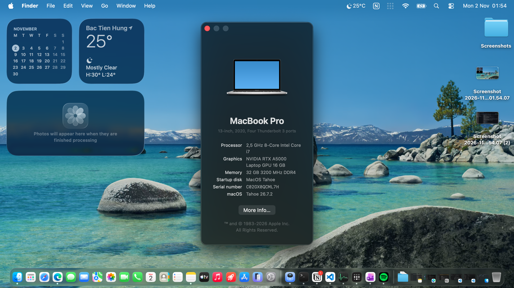
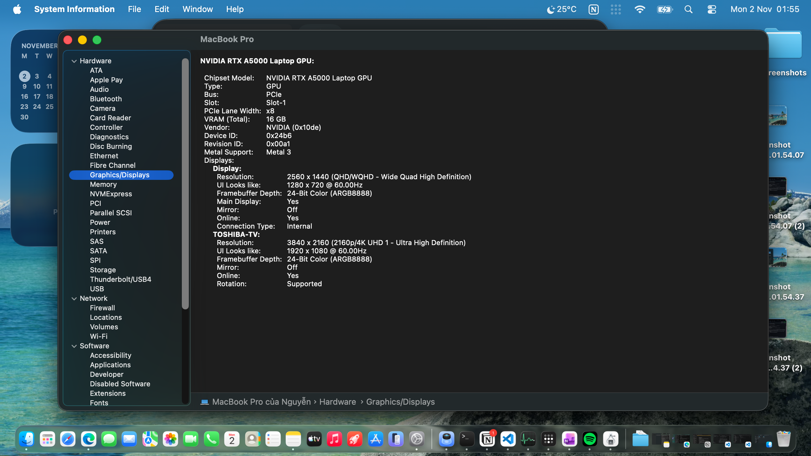
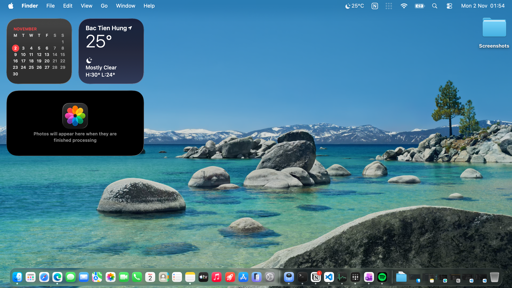

[Change to English version here!](https://github.com/datanonymus/Dell-Precision-7760-Hackintosh/README.md)
# Hackintosh Dell Precision 7760 | Tiger Lake i7-11850H | RTX A5000 Metal 3 | macOS Tahoe

Repository này chứa bộ EFI OpenCore dành cho máy trạm Dell Precision 7760.

### 💻 Cấu hình phần cứng:
- **CPU:** Intel Core i7-11850H Tiger Lake @ 2.50GHz (8 Nhân/16 Luồng)
- **GPU:** Intel UHD Graphics (Đã tắt trong BIOS) + **NVIDIA RTX A5000 Laptop 16GB VRAM**
- **RAM:** 32GB DDR4 3200MHz
- **Ổ cứng:** SSD Toshiba 512GB NVMe (Cắt 135GB cho macOS, phần còn lại cho Windows)
- **Wi-Fi/Bluetooth:** Intel Wi-Fi 6E AX210

### ✅ Những thứ đã hoạt động:
- **GPU:** Full Hardware Acceleration hỗ trợ Metal 3 trên NVIDIA RTX A5000 (Cảm ơn `nullMoth` vì những nỗ lực tuyệt vời của anh ấy!)
- **Mạng:** Nhận diện Native AirPort, Wi-Fi và Bluetooth (nhờ driver của `laobamac` bản 2.4.0-alpha)
- **Trackpad:** Hoạt động trơn tru với đầy đủ tính năng Multi-touch (Đa điểm)
- **Bàn phím:** Nhận phím kèm đèn nền (Well... tất nhiên! Nhờ công của BIOS điều khiển LED cả 🗿)
- **Pin:** Hiển thị phần trăm (Battery Percent) và quản lý pin hoạt động tốt
- **Cổng USB:** Đã nhận cổng (có một số giới hạn để map kext)
- **CPU:** Nhận đủ số nhân, số luồng. Hiển thị tên đầy đủ khi kiểm tra bằng CLI và hiển thị tên rút gọn trong "About this Mac".
- **Xuất hình:** Cổng HDMI xuất hình bình thường qua card NVIDIA.

### ❌ Những thứ không hoạt động (Và cách sống chung với lũ 🤷‍♂️):
- **Thanh điều chỉnh độ sáng:** Không hoạt động. Các app như Lunar, Monitor Control hay BetterDisplay đều không hoạt động. **Cách khắc phục:** Khởi động lại máy vào BIOS và tự chỉnh độ sáng thủ công trong thiết lập Display của BIOS.
- **Loa trong, cổng 3.5mm và Mic tích hợp:** Không hoạt động hoàn toàn do không có driver cho kiến trúc Intel SST (Well... đổ lỗi cho Intel và Apple đi, đừng đổ lỗi cho tôi 🤷‍♂️!) **Cách khắc phục:** Cắm USB Sound Card hoặc dùng loa/tai nghe Bluetooth để xuất âm thanh.
- **Camera tích hợp:** Không hoạt động do thiếu driver giao tiếp.
- **Sleep (Ngủ):** Phế toàn tập! Nếu bạn cố ép nó ngủ thì cái Laptop của bạn vẫn sẽ nóng như cái lò than thôi! Đừng mong chờ 1 con khủng long có thể ngủ mà không duy trì tính nóng trong người 🤷‍♂️! (Khuyên dùng Display Sleep).
- **Thunderbolt 4:** Không hoạt động do không có trình điều khiển Thunderbolt 4 của dòng Tiger Lake trên macOS.
- **Linh tinh:** Smart Card, SD Reader, WWAN và khay SIM không khả dụng vì đã nhường slot cho USB rồi.

### 📖 Hướng dẫn cài đặt chi tiết:
[Nhấn vào đây để xem chi tiết hướng dẫn cài đặt]()

### 📸 Ảnh chụp màn hình:

### 🏆 Ghi công & Giấy phép (Credits & License):
- [Acidanthera](https://github.com/acidanthera) cho OpenCore và hệ thống Kext lõi.
- [nullMoth](https://github.com/nullmoth) cho những nỗ lực tuyệt vời của anh ấy để giúp card NVIDIA hoạt động hoàn hảo trên nền macOS.
- [OpenIntelWireless](https://github.com/OpenIntelWireless) cho bộ Driver Intel Wi-Fi/BT ban đầu, và [laobamac](https://github.com/laobamac) vì đã port nó lên macOS 26 Tahoe.
- Giấy phép mã nguồn mở: **GNU GPLv3**.
