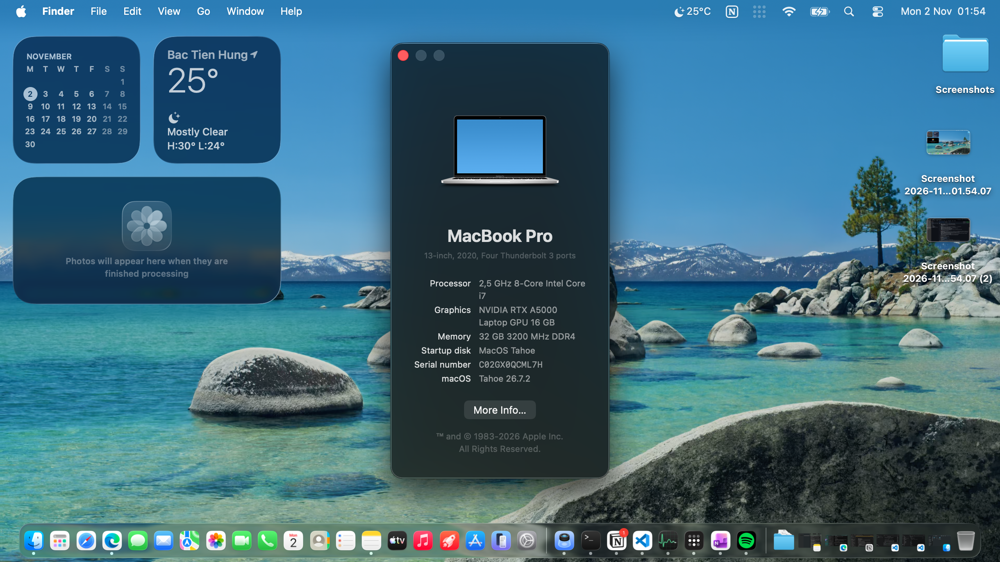
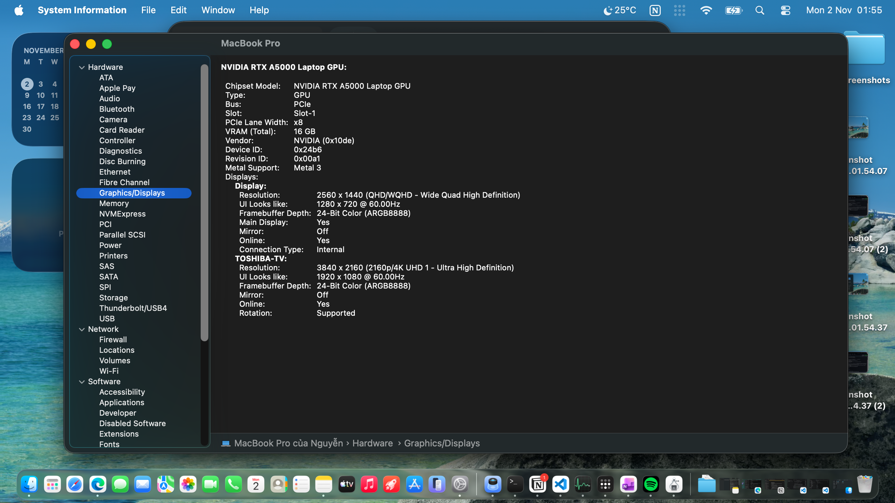
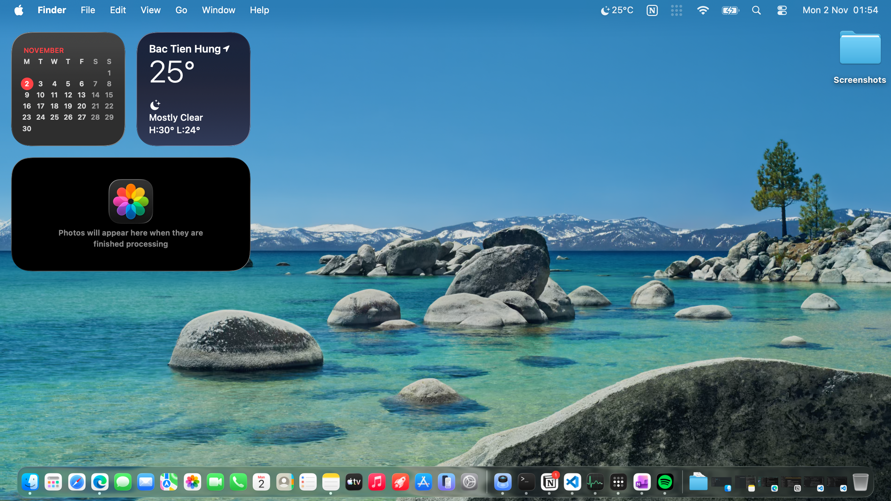

[Chuyển sang phiên bản Tiếng Việt tại đây!](https://github.com/datanonymus/Dell-Precision-7760-Hackintosh/blob/main/README-VIE.md)

# Hackintosh Dell Precision 7760 | Tiger Lake i7-11850H | RTX A5000 Metal 3 | macOS Tahoe

This repository contains the OpenCore EFI for the Dell Precision 7760 mobile workstation.

### 💻 Hardware Specifications
- **CPU:** Intel Core i7-11850H Tiger Lake @ 2.50GHz (8 Cores/16 Threads)
- **GPU:** Intel UHD Graphics (Disabled in BIOS) + **NVIDIA RTX A5000 Laptop 16GB VRAM**
- **RAM:** 32GB DDR4 3200MHz
- **Storage:** Toshiba 512GB NVMe SSD (135GB allocated for macOS, the rest for Windows space)
- **Wi-Fi/Bluetooth:** Intel Wi-Fi 6E AX210

### ✅ What Works
- **GPU:** Full Hardware Acceleration with Metal 3 support on NVIDIA RTX A5000 (Thanks to `nullMoth` for his amazing efforts!)
- **Network:** Native AirPort, Wi-Fi, and Bluetooth (thanks to `laobamac`'s 2.4.0-alpha driver)
- **Audio & 3.5mm Jack:** Working natively via the ancient `VoodooHDA_BL` kext! (Surprise! It's not dead after all 🐧)
- **Trackpad:** Works smoothly with full Multi-touch features
- **Keyboard:** Keys and backlight working (Well, of course! Thanks to the BIOS for controlling the LEDs 🗿)
- **Battery:** Battery Percent display and power management working well
- **USB Ports:** Ports recognized (with some limitations to map kexts)
- **CPU:** Recognized with full cores and threads. Displays full name when checked via CLI and abbreviated name in "About this Mac".
- **Display Out:** HDMI output works normally via the NVIDIA card.

### ❌ What Doesn't Work (And how to deal with it 🤷‍♂️)
- **Brightness Control:** Not working. Apps like Lunar, Monitor Control, or BetterDisplay do not work. **Workaround:** Reboot into BIOS and adjust brightness manually in the BIOS Display settings.
- ~~**Internal Audio, 3.5mm Jack, and Internal Mic:** Completely non-functional due to the lack of drivers for the Intel SST architecture (Well... blame Intel and Apple, don't blame me 🤷‍♂️!). **Workaround:** Plug in a USB Sound Card or use Bluetooth speakers/headphones for audio output.~~
- **HDMI Audio Output:** Dead. The nullMoth driver doesn't support audio pass-through yet. (Visuals only, no sound for you 🤷‍♂️).
- **Internal Camera:** Not working due to missing interface drivers.
- **Sleep:** Completely useless! If you try to force it to sleep, your laptop will still be as hot as a charcoal furnace! Don't expect a dinosaur to sleep without maintaining its internal heat 🤷‍♂️! (Display Sleep is recommended).
- **Thunderbolt 4:** Not working because there are no Thunderbolt 4 drivers for the Tiger Lake series on macOS.
- **Misc:** Smart Card, SD Reader, WWAN, and SIM tray are unavailable as their slots were yielded for USB.

### 📖 Detailed Installation Guide
[Click here to see the detailed installation guide](https://github.com/datanonymus/Dell-Precision-7760-Hackintosh/blob/main/TUTORIAL-ENG.md)

### 📸 Screenshots

### 🏆 Credits & License
- [Acidanthera](https://github.com/acidanthera) for OpenCore and core Kexts.
- [nullMoth](https://github.com/nullmoth) for his amazing efforts in making the NVIDIA card work perfectly on macOS.
- [OpenIntelWireless](https://github.com/OpenIntelWireless) for the initial Intel Wi-Fi/BT drivers, and [laobamac](https://github.com/laobamac) for porting it to macOS 26 Tahoe.
- Open-source license: **GNU GPLv3**.
